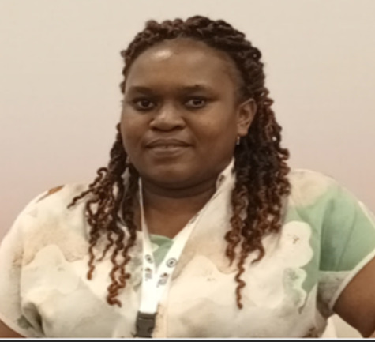

## About the project

The ARBO-WATCH project designs and deploys decision-support tools for dengue and chikungunya in Kenya, Somalia, and Ethiopia. The work uses primary and secondary data from these countries to uncover regional epidemiological patterns.

A consortium of nine institutions implements the project: ILRI, the Kenya Medical Research Institute, Kenya’s Ministry of Health, Jomo Kenyatta University of Agriculture and Technology, the Ethiopia Public Health Institute, the Global One Health Initiative, Ohio State University, Abrar University, and the Ministry of Health Somalia.

[About the project at ILRI](https://www.ilri.org/research/projects/arbo-watch-project)



## Curriculum

This curriculum strengthens analytical capacity for infectious-disease surveillance and outbreak response. It builds skill in research design, data analysis, modelling, visualization, and decision-support tools, using free and open-source software.

The curriculum has five modules. Each module has a set number of training days, and more material stays available online.

::: {.callout-tip title="Overall goal"}
Build an end-to-end skill set that moves participants from data collection to analysis, modelling, mapping, and decision-making.
:::

## Modules

::: {#workshop-listing}
:::

## JKUAT team

::: {.educator-list}

::: {.educator-card}
{.educator-photo}

::: {.educator-content}
### Henry Athiany

*Research biostatistician*

Henry Athiany is a Lecturer in the Department of Statistics and Actuarial Sciences (STACS) at JKUAT, with training in Biostatistics and Epidemiology and a background in Mathematics and Computer Science. His research spans epidemiology, infectious disease modelling, Bayesian and spatiotemporal analysis, clinical trials, statistical computing, bioinformatics, time-series forecasting, and mental health analytics. With over 15 years of experience working with large-scale eHealth and routinely collected healthcare data, he has contributed to national public health initiatives, including serving on Kenya’s COVID-19 Modelling Technical Committee and supporting multiple Ministry of Health projects on digital health systems, diagnostics optimization, and health information interoperability. He is also an experienced trainer in statistical software and research methods and has held leadership roles within the International Biometric Society and the Statistical Society of Kenya. Currently, he supports the ARBO-WATCH project as part of the JKUAT team.
:::
:::

::: {.educator-card}
{.educator-photo}

::: {.educator-content}
### Caroline Wanja Mugo

*Lecturer, biostatistics*

Caroline Wanja Mugo is a Lecturer in Biostatistics at JKUAT with a background in Biostatistics and Epidemiology. Her research interests include infectious disease epidemiology, statistical methods for public health, and data-driven decision-making. She has experience working with large datasets and routinely collected healthcare data, contributing to national public health initiatives. Caroline has also been involved in training and capacity-building efforts in biostatistics and epidemiology. She currently supports the ARBO-WATCH project as part of the JKUAT team.
:::
:::

::: {.educator-card}
{.educator-photo}

::: {.educator-content}
### Anthony Waititu

*Associate professor*

Gichuhi A. Waititu is an Associate Professor of Statistics at Jomo Kenyatta University of Agriculture and Technology (JKUAT), Kenya. He currently serves as the Dean of the School of Mathematics and Physical Sciences at JKUAT. He has over twenty years of experience teaching applied statistics at university level, alongside research and academic leadership. His research interests focus on machine learning and artificial intelligence, with applications in data science and statistical modelling.
:::
:::

::: {.educator-card}
{.educator-photo}

::: {.educator-content}
### Charity Wamwea

*Lecturer, actuarial science*

Charity Wamwea is a lecturer and researcher in Actuarial Science, Applied Statistics, and Mathematical Finance at Jomo Kenyatta University of Agriculture and Technology (JKUAT). She specializes in statistical, risk, and financial modelling, machine learning, and data science, with research interests spanning epidemiology, public health, survival analysis, infectious disease modelling, and non-communicable diseases. Her work applies quantitative methods to health systems, disease surveillance, and financial risk management.
:::
:::

:::

## Partners

::: {.partner-list}
- [International Livestock Research Institute](https://www.ilri.org)
- [Jomo Kenyatta University of Agriculture and Technology](https://www.jkuat.ac.ke)
- [Kenya Medical Research Institute](https://www.kemri.go.ke)
- [Kenya Meteorological Department](https://meteo.go.ke/)
- [Ethiopian Public Health Institute](https://ephi.gov.et/)
- [Abrar Research & Training Centre](https://arachti.org/)
- [Federal Ministry of Health in Somalia](https://moh.gov.so)
- [Global One Health Initiative](https://oia.osu.edu/global-one-health-initiative)
- Kenya’s Department of Disease Surveillance and Epidemic Response
- [Ohio State University](https://osu.edu)
:::
